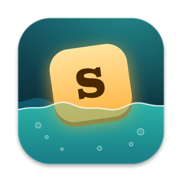
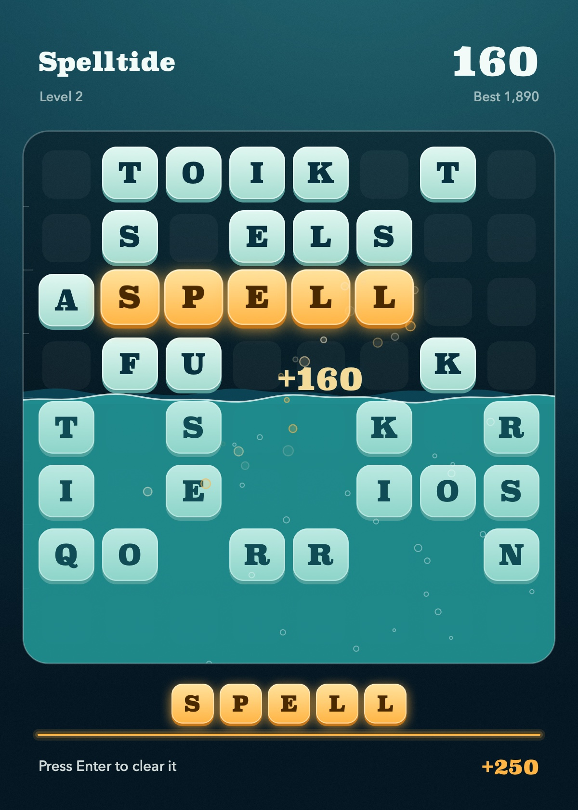

# Spelltide

A word game for the Mac, written in C++.

Letters flood an 8 by 8 tank. Spell words with them to drain it. The letters
come faster the longer you last. If the tank stays full for 5 seconds, the
game is over.



## Build it

You need a Mac running macOS 12 or later, and Apple's command line tools. If
you have never installed them, run this once:

```sh
xcode-select --install
```

Then build and start the game:

```sh
git clone https://github.com/aiur100/spelltide.git
cd spelltide
./build.sh
open build/Spelltide.app
```

That is the whole build. There is no Xcode project and nothing else to
install. `build.sh` compiles one file with `clang++` and puts the result, the
word list and the icon into `build/Spelltide.app`.

To keep the game, drag `build/Spelltide.app` into your Applications folder.

## How to play

| Do this | To |
| --- | --- |
| Type a letter | Pick a tile with that letter |
| Click a tile | Pick that exact tile |
| Enter or Space | Clear the word, if it is a real word |
| Delete | Take back the last letter |
| Esc | Take back every letter |
| Cmd-N | Start a new game |

Words need 2 letters or more. The tiles do not have to touch.

The water shows how full the tank is. When the tank is full the water turns
red and a countdown runs around the rim. Clear any word before it runs out
and you are safe again.

Clicking away from the window pauses the game.

## Scoring

A word scores its length times itself, times 10. Long words are worth far
more than short ones.

| Letters | Points |
| --- | --- |
| 2 | 40 |
| 3 | 90 |
| 4 | 160 |
| 5 | 250 |
| 6 | 360 |
| 7 | 490 |
| 8 | 640 |

A new level starts every 15 seconds. Each level, letters arrive about 12%
faster. Your best score is saved between games.

## How it is put together

| File | What it holds |
| --- | --- |
| `src/Game.hpp` | The rules: the board, letters, words, scoring, speed. Plain C++ with no Apple code, so it can be tested or moved to another system by itself. |
| `src/main.mm` | The window, drawing, keys and sound. This is Objective-C++, which is C++ that can call macOS. |
| `words.txt` | The word list, one word per line. |
| `Info.plist` | Tells macOS the app's name and icon. |
| `Spelltide.icns` | The icon. |
| `build.sh` | Builds the app. |
| `make-icon.sh` | Rebuilds the icon. |

Everything on screen is drawn in code with Core Graphics. There are no image
files in the game, and the app paints its own icon too.

## Handy extras for tinkering

Save a picture of a screen without playing. The scene can be `title`, `play`,
`danger` or `over`:

```sh
build/Spelltide.app/Contents/MacOS/Spelltide --snapshot out.png play
```

Print how long drawing takes and how many frames a second you get:

```sh
SPELLTIDE_STATS=1 build/Spelltide.app/Contents/MacOS/Spelltide
```

Change the icon by editing `Icon()` near the bottom of `src/main.mm`, then:

```sh
./build.sh && ./make-icon.sh && ./build.sh
```

Change the rules at the top of `src/Game.hpp`. The board size, the 5 second
limit, the level length and the starting letters are all named numbers there.

## Word list

`words.txt` is the ENABLE word list, about 173,000 English words, which its
authors placed in the public domain. To use a different list, replace the
file with any text file that has one lowercase word per line, then build
again.
